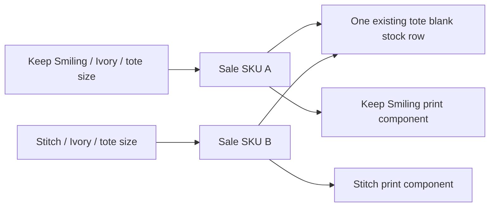

# Dressing Bear — Stage 2 review

Status: Stage 2A was deployed on 18 October 2026. Stage 2B was approved and
deployed on 19 October 2026. Stage 2C was approved and deployed on 19 October 2026.
The plan below records the scope and follow-up options.

Delivered: **2A — stable colour/size records and SKUs**. See
[the implementation and validation record](catalogue-sku-stage2a.md).
Delivered: **2B — additional store collections**. See
[the collection implementation and validation record](catalogue-collections-stage2b.md).
Delivered: **2C — draft publishing**. See
[the publication implementation and validation record](catalogue-publishing-stage2c.md).

## Current baseline

Read-only verification on 18 October 2026 confirmed the Stage 1 production image
and the following counts:

| Item | Current count |
| --- | ---: |
| Products, all active | 42 |
| Store collections | 23 |
| Colour variants | 105 |
| Offered size records | 357 |
| Populated colour SKUs | 0 |
| Active sizes without a stock link | 0 |
| Physical families | 6 |
| Physical blank stock rows | 25 |

These are catalogue counts, not available unit quantities.

The existing structure already separates physical categories and families from
store merchandising. Keep that structure and the shared blank links.

## Findings and options

| Finding | Practical improvement | Tradeoff |
| --- | --- | --- |
| Saving a product preserves its colour IDs but deletes and recreates its size rows. | Update retained size records in place; archive removed sizes. | Every reader of offered sizes must exclude archived sizes. |
| SKU exists only on a colour variant, so it cannot identify a particular size. | Give each saleable product/colour/size its own stable SKU. | Requires an additive migration and a reviewed backfill. |
| Each product belongs to one store collection. | Allow additional collection memberships referencing the same product. | Listing filters, counts, media and collection lifecycle actions must agree. |
| Products have an archive flag but no draft state. | Add an explicit draft/published state, keeping archive separate. | Visibility must be enforced in every public reader and new-order path. |

| Approach | Advantage | Disadvantage |
| --- | --- | --- |
| Keep the current model | No migration. | Size identity, collection reuse and draft gaps remain. |
| **Extend the existing records in small releases** | Preserves URLs, physical stock links and existing workflows. | Needs compatibility checks at each release. |
| Replace products and variants with a new model | Greater redesign freedom. | Unnecessary migration and maintenance cost at this scale. |

The incremental option is recommended for Dressing Bear.

## 2A — stable records and unique SKUs

### Everyday behaviour

- Each offered size displays a SKU next to its colour, size and shared stock
  source. Staff can copy and search the SKU.
- Generate a short permanent code such as `DBV-000001`. Names and dimensions
  remain readable beside it; changing a name never regenerates the code.
- Generate codes automatically in the first release. Reserve that prefix and
  check the existing legacy colour-SKU field for conflicts before migration.
- Keep the current colour-SKU field compatible for existing callers. New sales
  use the size SKU; historical order snapshots remain unchanged.
- A normal product edit retains the IDs and SKUs of unchanged sizes.
- Removing a size hides it from sale and retains its identity. Re-adding the
  same size to the same colour restores that record and its SKU.
- Two designs using the same blank have different sale SKUs and reference the
  same physical stock row. Neither size record gains its own quantity field.



This diagram describes the existing blank/print sales model with new sale
identifiers. It does not introduce finished-goods stock.

### Technical boundary

Extend `VariantSizeStock` with a unique sale SKU and an archive flag. Preserve
all 357 current IDs and `plainTshirtStockId` bindings during backfill. Change
product reconciliation to update retained cells instead of rebuilding them.
The database must guarantee unique generated codes under concurrent writes.

Filter archived size records in the product form, availability readers,
inventory design lists, storefront detail/cards, checkout and admin order
product selection. Historical orders and stock restoration continue using
their recorded blank and print IDs. Submitted cell IDs must belong to the
selected product/colour; size identity cannot be reassigned between products.

New checkout and admin-created order lines snapshot the selected size SKU into
the existing `OrderItem.sku` field. Do not rewrite old order lines. Preserve
current colour-level marketing-feed identifiers; changing those could create
duplicate external catalogue entries and is a separate integration decision.

The current cart contract using product, colour variant and size stays valid.
SKU lookup resolves to those same validated records; it is not a new stock
allocation path. No POS checkout is introduced in 2A.

### Reviewable UI

```text
Colours and sizes

Natural Ivory
  Size                     Sale SKU       Stock source       Available
  12" × 12" × 4"            DBV-000001     Shared tote blank   Live balance

SKU is generated once. Product edits retain it.
Remove size → hide from sale; retain SKU and history.
```

The code is illustrative, not a promised mapping to an existing product.
Stock is shown as a derived balance and is edited only in Inventory.

## 2B — additional store collections

Keep the existing primary collection and department fields for breadcrumbs,
public routes and legacy callers. Add a join table for **additional** collection
memberships; do not copy product, variant or stock records.

UI: **Primary collection** followed by an optional searchable **Also show in**
selector grouped by department. Additional memberships may deliberately expose
one product in another department. The primary breadcrumb stays unchanged.

Collection and department listings, admin filters, counts and tile images must
include memberships and count each product once. Primary-collection changes
must remove any redundant additional membership in the same transaction.
Collection renames/moves preserve links; deletion checks primary and additional
memberships and reports which products need reassignment. Existing URLs and
redirects remain valid. Start with no additional memberships for existing data.

## 2C — draft publishing

Add an explicit draft/published state. Existing products migrate as published
and retain their current archive flag. New-product UI defaults to draft.
Editing a published product does not silently unpublish it.

UI: **Save draft** and **Publish**, plus All / Published / Draft / Archived
filters. A draft requires basic details, including a name, primary collection
and valid base price; media, print setup and offered variants can be completed
before publishing. This keeps the current price and collection relationships
without introducing a second draft-product database.

Publishing validates complete media, offered variants, applicable stock
bindings and the current required DTF component. The later stock-lifecycle
stage separately decides when prints are optional.

Drafts stay out of public pages, search, related products, category counts and
images, feeds, sitemaps, structured data and new online/admin orders. Direct
URLs and existing carts cannot bypass publication checks. Existing orders and
payment callbacks still complete using their saved order records. Publishing
and unpublishing must invalidate relevant catalogue caches immediately.

## Acceptance and rollout

For 2A, verify on a restored production copy:

1. All existing size IDs and stock bindings survive migration and a no-change
   product save; all current combinations receive unique sale SKUs.
2. Name/image/price edits preserve size IDs, SKUs and stock quantities.
3. Remove/re-add, concurrent code generation, ownership rejection and archived
   size filtering behave correctly.
4. Two designs sharing a blank still consume that one pool; simultaneous
   last-unit sales cannot oversell it.
5. New order lines store the size SKU. Old orders, order deletion/restoration,
   cancellation stock references, product URLs and feed IDs stay compatible.

Run focused tests and checks sequentially after CPU, RAM and Docker checks.
Use capped containers and existing dependencies. Back up before migration and
compare IDs, stock, mappings and order snapshots before/after rollout.

Once sizes have been archived, the current Stage 1 image is not a safe general
rollback: it does not filter those rows and it recreates sizes on save. Keep an
archive-aware compatible rollback build or use a validated fix forward. Do not
drop new columns or delete archived identities to make older code run.

Stages 2A, 2B and 2C are delivered.
Stock modes, production, movement history, physical
count reconciliation and POS remain later stages.

## Evidence and reference patterns

Local findings: `prisma/schema.prisma`; `app/admin/products/actions.ts`
(`reconcileVariants`); `app/_lib/products.ts`; `app/_lib/admin-products.ts`;
`app/_lib/taxonomy-media.ts`; `app/_lib/meta-feed.ts`;
`app/checkout/actions.ts`; and `app/admin/orders/actions.ts`.

Shopify distinguishes products, variants and merchandising collections in its
[products and collections documentation](https://shopify.dev/docs/storefronts/headless/building-with-the-storefront-api/products-collections).
Its [SKU guidance](https://help.shopify.com/en/manual/products/details/sku)
describes internal item identification and distinguishes SKUs from barcodes.
Its [product status model](https://shopify.dev/docs/api/admin-graphql/latest/enums/ProductStatus)
separates draft, active and archived states. These are reference patterns;
the phased design above is specific to Dressing Bear's existing shared-stock
model and is not a proposal to adopt Shopify.
